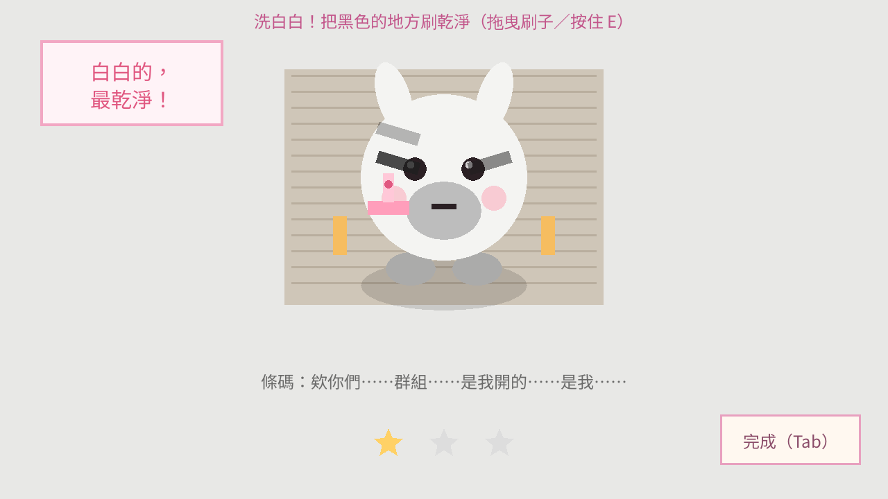
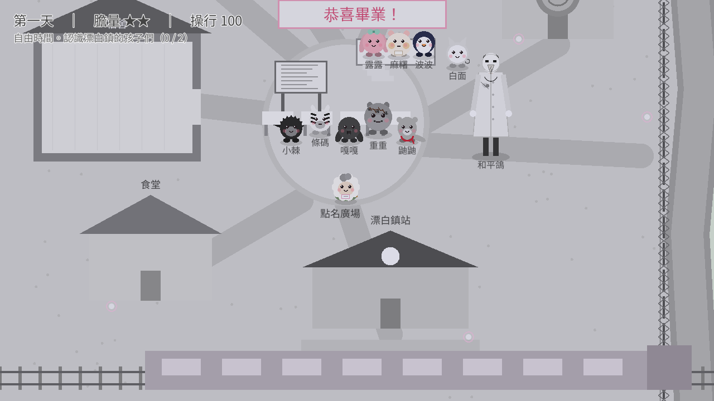

# Rule Zero — Godot 原型

第一章「歡迎回來」**完整三天**的可玩原型（約 40–60 分鐘，正式版目標 90 分鐘）＋第二章「漂白鎮」**完整可玩**。第一章的結束卡片可以直接「前往第二章」（第一章的選擇會帶過去）；破完第一章後，標題的「選擇篇章」也能進第二章。
用來驗證：守則與膽量系統、對話節奏、「可愛 → 一點點怪」的氛圍。

> 故事的真相與角色設定：[`docs/story.md`](../docs/story.md)（以這份為準）。
> 真結局：修理室的鑰匙（Fen 的樹屋）＋六團記憶碎片（每輪三團）＋「老師」的線索（鎮長公館）→ 第三天的鐘聲 → 鎮長崩潰 → 裸眼 3D 追逐戰（`scripts/chase/chase.gd`：手繪背景＋深度圖視差、比小布近的東西衝出框外；素材由 `tools/prep_chase2d.py` 整理）→ 剪刀 → 車掌 → 前往第二章。
> 小屋室內：`scripts/world/interiors.gd`（房間資料）＋ `scripts/ui/interior.gd`（點擊調查）。美術放 `art/int_<房間>.jpg` 就會取代程式畫的房間。


## 執行
1. 安裝 [Godot 4.3](https://godotengine.org/download)（標準版即可，不需要 .NET）。
2. Godot → 匯入 → 選擇本資料夾的 `project.godot` → 按 F5。

## Windows／Android／iOS 版
```
GODOT=/path/to/godot tools/build_platforms.sh            # Windows＋Android
GODOT=/path/to/godot tools/build_platforms.sh ios        # Xcode 專案（要先填 Apple 團隊 ID，在 Mac 上編譯）
```
產生 `build/windows/RuleZero.exe`（單一執行檔）與 `build/android/RuleZero-debug.apk`（debug 簽章，側載測試用）。需要的工具與各平台待辦見 `docs/platform_plan.md` 第 9 節。

## 網頁版／手機試玩
```
GODOT=/path/to/godot tools/build_site.sh   # 需要 Godot 4.3 Web 匯出範本
```
產生 `public/`（專案列表 `site/index.html` ＋ `rule-zero/` 遊戲），並推上 GitHub。遊戲網址為 `<網站>/rule-zero/`。
Cloudflare Pages 連結此 repo，設定「建置指令：留空」「建置輸出目錄：`public`」，推送後會自動更新網站。
- Cloudflare Pages 單檔上限 25 MiB：引擎 `index.wasm`（約 35MB）會被切成 `index.wasm.part0/1`，頁面載入時再接回來。
- 使用單執行緒版本，不需要伺服器設定特殊標頭，一般靜態網站主機都能放。
- 手機請橫放；左下搖桿移動、右下「互動」「日記」，對話點畫面任何地方前進。
- 網頁版本身沒有密碼；需要保護請用外層網站或 Cloudflare Access。
- 中文字型為內建的 Noto Sans TC 子集（`game/fonts/`，SIL OFL 1.1）。對話新增文字後要重跑 `python3 tools/subset_font.py <NotoSansCJK-Regular.ttc>`。

## 操作
| 按鍵 | 功能 |
|---|---|
| WASD / 方向鍵 | 移動 |
| E / 空白鍵 / Enter | 互動、下一句 |
| Tab / Esc | 日記（守則、發現的事情、拆下名牌） |
| 手把 | 左搖桿／十字鍵移動、A 互動與下一句、START／BACK 日記（PlayStation、Switch 手把由 Godot 自動對應） |
| 手機 | 左半邊按住任何地方就出現搖桿、右下「互動」「日記」、點畫面前進對話 |
| F3 | 除錯：顯示隱藏的懷疑值 |

## 已實作
- 依概念地圖（`docs/art/00_town_map.jpg`）配置的小鎮：守則廣場、鐘塔、鎮長公館、修理室、鏡之屋、森林小徑、河流與石橋、居民小屋、火車站
- 角色外觀依設定圖簡化：露露薄荷綠蝴蝶結、鎮長高禮帽、小布綠斗篷、麻糬（倉鼠）的空白名牌、小玉（三花貓）
- 序章火車 → 歡迎會 → 接糖果小遊戲（含灰色鈕扣異常）→ 守則教學
- 第一天自由探索（7 個地點，拜訪 2 個進入傍晚）、露露叫錯名字、鏡子凝視 10 秒
- 夢境 1、第二天公告欄異常（第 9 條「回來」變粗）、鐘塔指針停在三點
- 膽量系統：問「以前」、拆名牌、晚上偷溜出門，膽量不足時選項變灰
- 夜晚的小鎮：居民面朝鐘塔，鈕扣眼睛跟著你轉；Fen 的對話
- 第三天：公告欄第 4 條的紅線、鎮長依懷疑值的三種反應、露露的夢（安慰她／讓她懷疑）
- 森林：越往深處顏色越淡；零件堆（黃色蝴蝶結、名牌、狐狸尾巴、No.46 的小綿羊），調查 3 樣（含小綿羊）觸發高潮
- Fen：「你是第四十七個小布。」→ 下午三點的鐘聲 → 衝出去（膽量）／躲著（露露告發）
- 修理室與「一針一針縫起來」的畫面，結尾台詞依選擇變化（小遙／小布）
- 章節結算（秘密數、線頭數、懷疑值）→ 不等按鍵，直接播第二章開場（兩個戳章、新的 Fen、第 11 條守則）
- 日記「記下的事」：謎題線索自動記錄（例如 No.46、第四十七個小布）


- 揉麵團節奏小遊戲：判定寬鬆，連續 8 個 Perfect 會讓露露哼起「另一首歌」（第 8 個秘密）；沒成功可以再找露露揉一次
- 標題畫面：繼續／新遊戲／離開；車票上的戳章＝完成的章數＋1，玩完第一章後角落多一行「歡迎回來。」
- 自動存檔：每天早上存一次（Tab 選單可回到標題）；完成一章會清掉當章存檔並記錄在跨周目資料


## 存檔位置
`user://save.json`（當章進度）與 `user://meta.json`（跨周目）。Windows 為 `%APPDATA%\Godot\app_userdata\Rule Zero 第零條規則（原型）\`。

## 美術與音效（v2 素材包）
- 小鎮：`art/town_map.png`（簡化地圖，世界座標＝原圖 × 1.5，見 `world/town.gd` 的 `at()`）；只能走在石板路、樓梯、橋上（`art/walk_mask.png`，由 `tools/build_walk_mask.py` 從地圖產生；換地圖後重跑一次）
- 小布的房間：`art/room.jpg`（地圖右側的獨立室內），由「小布的家」門口進出；第一天晚上不能出門
- 森林：`art/forest_map.jpg`（× 1.6），只能走在小徑上（`art/forest_mask.png`，同一支工具產生）；零件散在各條岔路
- 全畫面背景：`art/bg_*.jpg`，對話腳本用 `@bg 名稱`（車廂、月台、廣場、麵包店、修理室、鐘塔內部、夜晚房間、三張醫院走廊夢境）
- 物件特寫：`art/item_*.png`，對話腳本用 `@show 名稱`／`@show none`（車票、名牌、照片、郵袋、時鐘、森林裡的零件、立繪…）
- 布料 UI：`art/ui_*.png`（對話框、選項、日記紙、守則木板），`ui/ui_skin.gd`
- 車掌（第二天起站在月台盡頭）、小狗居民（掃落葉，有閒聊與一次驚悚對話）
- 角色行走圖：`art/walk_*.png`（3 步 × 4 方向，每格 192px），NPC 會轉頭看說話的對象；夜晚的居民會一直盯著小布
- 對話頭像：`art/face_*.png`（每人 8 種表情），依台詞自動挑表情（`dialogue.gd` 的 `_expression()`）
- 鏡子：`art/mirror_states.png`（空鏡／浮現／低頭／貼掌），掀開布後在房間裡顯示
- 背景音樂：日間小鎮、夜間探索、記憶揭露（`audio/bgm_*.ogg`，交叉淡入淡出，夢境與真相時切換）
- 音效：對話、互動、選項、選單、開門、腳步、異常（`audio/sfx_*.wav`，`autoload/sound.gd`）
- 環境音：森林的風聲、夜晚的蟲鳴、遠處的鈴聲；驚悚台詞的低音與雜訊（`audio/amb_*.ogg`、`sfx_bell_far/creepy/glitch`，由 `tools/make_ambience.py` 合成）
- 演出：畫面邊緣的目標箭頭、NPC 轉頭看小布與呼吸、第三天居民盯著看、森林暗角與鏡頭晃動、驚悚台詞閃爍色偏（`@scare`，`ui/screen_fx.gd`）
- 素材處理腳本與原始檔不在 repo 內；重新切圖時維持相同的格子尺寸即可直接替換

## 第二章「漂白鎮」
劇本：`docs/script/chapter2.md`。程式：`scripts/chapter2.gd`（流程）、`scenes/chapter2.tscn`、`dialogue/chapter2.txt`（標籤以 `c2_` 開頭）。


- 第一章的夜車結局（「窗外出現一個黑色的鎮」）→ 結束卡片「前往第二章」→ 第二章的序章（灰色車廂、「壞孩子」轉介單）。第一章的旗標會帶過去（例如露露隔岸揮手的方式、Fen 的尾巴）
- 破完第一章後，標題的「選擇篇章」可以直接進第二章
- 漂白鎮地圖：全部黑白灰，只有河對岸的模範生宿舍是彩色的；鐵絲網過不去
- 六個居民（白面、小棘、條碼、嘎嘎、重重、鼬鼬）與和平鴿（人類，戴鴿子面具，玩偶只到他的膝蓋）
- 操行成績單（畫面左上與日記）、漂白鎮矯正守則（公告欄）、漂白鎮配色的對話框
- 序章（可調查的車廂、轉介單「校外參訪」）→ 抵達 → 成績單與守則 → **道歉練習** → 自由時間（認識 2 個居民）→ 傍晚隔著鐵絲網 → 夜間點名（被塗掉的第 8 個名字）→ 枕頭下的彩色鈕扣 → 夢境 1
- 道歉練習：節奏遊戲，按錯時被電的是重重；連續亂按 5 次 → 電擊轉到小布身上，要按住「我很乖」撐過去（膽量 -1、操行 -10）


**第二天**
- 早上：公告欄第 3 條多了字、條碼剩 2 條斑紋；早餐的白色糖果（吃掉／藏起來——藏起來的晚上用得到）
- **洗白白**：拖曳刷子（或按住 E）把條碼的斑紋刷掉，他越刷話越破碎；剩一點點時按「完成」→ 保住他的一段記憶（操行 -10）
- **找出壞孩子**：三輪找不同（嘎嘎、鼬鼬可以舉報或放過）；第三輪沒有不一樣的——小棘舉手：「是小布。」
- **治療室**：按住「我很乖」撐過三個問題
- 自由時間：**一二三木頭人**去和平鴿的大衣口袋拿嘎嘎的底片 → 三張照片（白臉狐狸與「遙」、小棘攔信、燒壞的「涅槃」）→ 拿照片去問白面（Fen 的父親、和平鴿面具的裂痕）
- 第二晚點名：名單上的第 8 個名字是「遙」，可以替他回答「到」
- 夜晚跟鼬鼬偷溜（舉報過鼬鼬就不會來）：治療室窗戶的剪影與哼歌、辦公室（愛的日記、涅槃計畫的夾板）、月台偷聽和平鴿與車掌 → 被抓到
- 夢境 2



**第三天、畢業典禮、結尾**
- 早上：公告欄多了第 8 條；條碼剩最後一條斑紋
- 鐵絲網：波波認出小棘 → 小棘的偽裝崩潰 → 和平鴿抱住他 → 波波抓住通電的鐵絲網
- **反省會**：念罪狀卡；第 5 張開始是孤兒院大人說過的話，可以塞進口袋不念（膽量 -1、操行 -15）
- **修剪**：一根一根剪掉小棘的刺；肚子裡掉出「給露露　波波」的信；可以留下最後一根刺（膽量 -1、操行 -10）
- 傍晚：麻糬鑽過鐵絲網、小棘叫出他的本名「小滿」；可以在麻糬的名牌寫上名字、把信折成紙飛機射給露露
- **搶椅子**：最後一輪剩小布和重重，可以故意不坐（替他進治療室，按住 10 秒）
- **畢業典禮**：條碼被處分；**重新塞棉花**時可以繼續縫完／把針刺向面具（鼬鼬切換軌道）／把針交還
- 存活判定（docs/script/chapter2.md 7.2）：每個居民各自依前面的選擇決定上車、畢業、處分或留在月台
- 操行低於 30：壞結局「特別的愛」——選一段記憶讓和平鴿剪掉，一位本來能上車的居民被留下
- 結尾：轉介單的事由繡出「沒有阻止」、涅槃計畫區的廣播 → 結算畫面（秘密、操行、六個居民的去向）
- 標題畫面：第三個白色戳章；車票下方多一排名牌（處分＝灰色剪一角，滑鼠移上去「維持中」；畢業＝字被漂掉）。**合併新版第一章後，標題畫面換成新版，這兩樣還沒移植過去**（資料 `meta.ch2_fates` 仍會記錄）



## 外包素材（第二章 P0，已接入）
交件說明與檔案表：`docs/vendor/ch2_p0/`（AI 生成，Steam 上架需揭露；提示詞在 `generation_prompts.json`）。
- 地圖：`art/ch2/backgrounds/ch2_bg_town_day.jpg`（原檔 3200×2300 縮成 1600×1150）。鐵絲網另一邊走不過去（`BleachTown.BLOCKED`）。
- 小人：`art/ch2/characters/sprites/`，以 0.5 倍顯示。缺圖時自動退回程式繪製的樣子。
- 立繪：`art/ch2/characters/portraits/`（縮成 512×768），對話時顯示在右邊；狀態不符時不顯示。
- 配樂：漂白鎮（自由時間）、和平鴿（點名、治療室、畢業典禮）、矯正時間（洗白白、找出壞孩子、反省會、修剪、重新塞棉花）。
- 音效：對話打字聲、哨音（腳本裡的 `@sfx`）、電擊（所有小遊戲的電擊都換成外包音效）。

## 跨平台與系統（兩章共用）
- 手把、浮動搖桿；畫面上的操作說明依最後使用的裝置顯示（鍵盤「按 E」、手把「按 A」、觸控「點畫面」，`GameState.hint()`）。
- 安全存檔：先寫 `.tmp`、讀回確認後才換上，上一份留成 `.bak`；主檔壞掉時自動讀 `.bak`。存檔記錄目前在第幾章，「繼續」會回到正確的章節。
- 音量：日記裡的「配樂」「音效」滑桿，兩章共用、存在 `meta.json`。不新增 Audio Bus（Godot 4.3 網頁版新增的 bus 沒有聲音），音量直接加在每個播放器上（`scripts/autoload/audio.gd`）。
- 正式 Logo 與 App 圖示：`docs/marketing/`、`game/art/branding/`。

## 尚未實作（下一步）
- 貓居民只有表情圖（沒有行走圖），目前不在地圖上
- 地圖上的建築遮擋（角色走到屋簷後面時不會被擋住）

## 專案結構
```
game/
├── project.godot
├── scenes/main.tscn            # 進入點
├── dialogue/chapter1.txt       # 全部對話（語法：docs/dialogue-format.md）
├── scripts/
│   ├── main.gd                 # 章節流程、場景配置、互動分派
│   ├── autoload/
│   │   ├── game_state.gd       # 天數、膽量、懷疑值、旗標、秘密
│   │   ├── dialogue.gd         # 對話 UI 與執行
│   │   └── dialogue_parser.gd  # 對話腳本解析與檢查
│   ├── chapter2.gd             # 第二章的流程（scenes/chapter2.tscn、dialogue/chapter2.txt）
│   ├── ch2/                    # 第二章專用的 HUD、公告欄、玩家、角色、觸控、結算卡（不和第一章共用）
│   ├── minigames/              # 第二章的 9 個小遊戲
│   ├── world/                  # 小鎮、森林、玩家、角色繪製（bleach_town.gd：漂白鎮）
│   ├── ui/                     # 公告欄、HUD／日記、修理室、結算、結尾選單
│   └── audio/tones.gd          # 程式合成的音樂盒音色
└── tests/
    ├── lint_dialogue.gd        # 檢查對話腳本（兩章）
    ├── chapter2_test.gd        # 第二章四條路線（含刺向面具、壞結局）跑到結尾、存檔讀檔
    ├── transition_test.gd      # 第一章結尾 → 第二章、讀第二章存檔、選擇篇章
    ├── letters_test.gd         # 送信任務：中途回郵局、問過「以前」，送完都能交差
    ├── save_test.gd            # 安全存檔、音量、手把、操作說明
    ├── smoke_test.gd           # 自動跑完兩條主要路線（第一～三天＋第二章開場）、存檔讀檔
    ├── world_test.gd           # 走路、碰撞（只能走在路上）、互動點都站得到
    ├── endings_test.gd         # 各結局與輪迴記憶
    ├── quests_test.gd          # 支線委託
    ├── idle_test.gd            # 閒聊輪替（驚悚的那段只出現一次）
    ├── forest_test.gd          # 森林：每樣東西都走得到、按得到
    ├── interiors_test.gd       # 小屋：從門口進去、每樣東西都點得到、離開
    ├── chase_test.gd           # 追逐戰：看到預告就躲 → 跑得到修理室；不動 → 被抓
    ├── walk_routes_test.gd     # 模擬玩家用方向鍵走遍小鎮／森林，找出會卡住的地方（路線：tools/make_routes.py → tests/data/）
    ├── screenshots_ui.gd       # 標題畫面截圖
    ├── screenshots.gd          # 產生截圖（需要顯示環境）
    ├── screenshots_day3.gd     # 第三天畫面截圖
    ├── screenshots_fx.gd       # 演出截圖：方向箭頭、NPC 轉頭、第三天盯著看、森林暗角、驚悚閃爍
    ├── screenshots_interiors.gd # 小屋室內截圖
    ├── screenshots_chase.gd    # 追逐戰截圖
    └── screenshots_ending.gd   # 真結局（剪刀、回憶）截圖
```

## 測試
```
godot --headless --path . -s tests/lint_dialogue.gd
godot --headless --path . -s tests/smoke_test.gd
godot --headless --path . -s tests/world_test.gd
godot --headless --path . -s tests/endings_test.gd
godot --headless --path . -s tests/quests_test.gd
godot --headless --path . -s tests/idle_test.gd
godot --headless --path . -s tests/forest_test.gd
godot --headless --path . -s tests/interiors_test.gd
godot --headless --path . -s tests/chase_test.gd
godot --headless --path . -s tests/chapter2_test.gd
godot --headless --path . -s tests/transition_test.gd
godot --headless --path . -s tests/letters_test.gd
godot --headless --path . -s tests/save_test.gd
```

## 字型
原型使用系統的中文字型（Windows：微軟正黑體；macOS：蘋方）。
正式版需要打包可商用授權的字型（例如 Noto Sans TC 或圓體），再上架 Steam。
