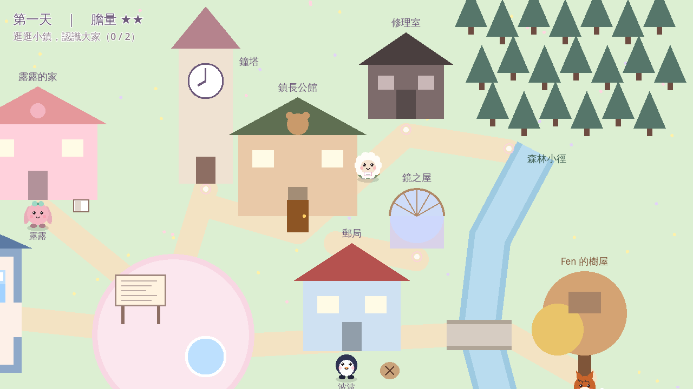
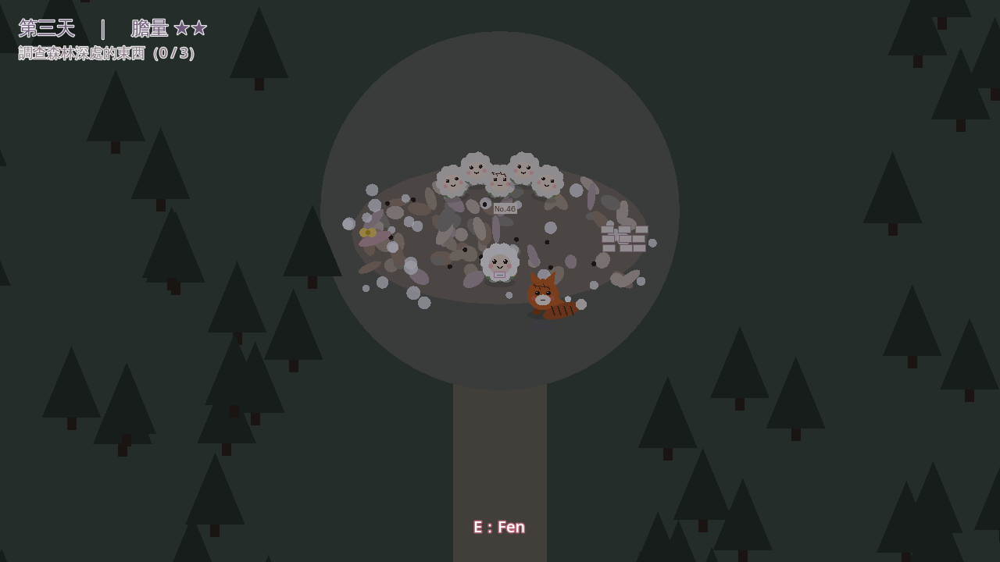
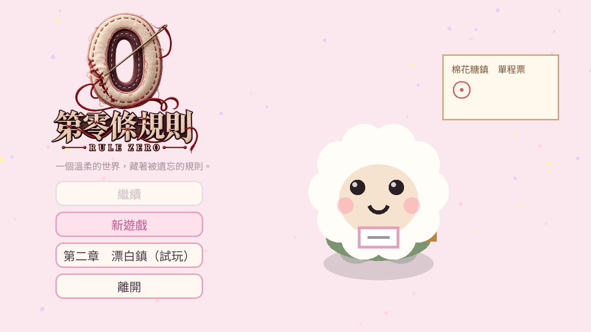
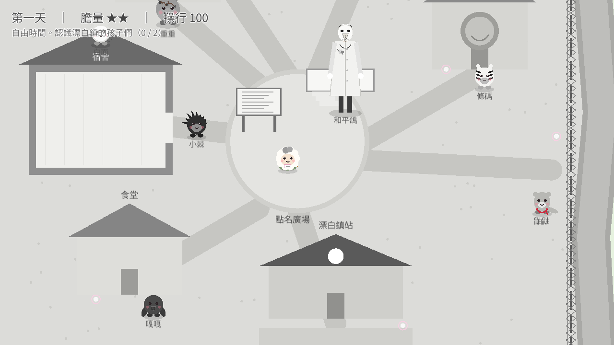
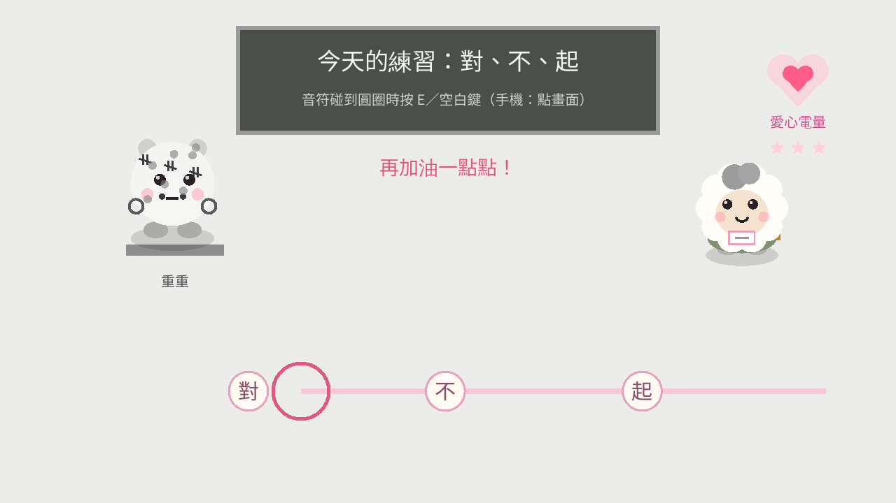

# Rule Zero — Godot 原型

第一章「歡迎回來」**完整三天**的可玩原型（約 40–60 分鐘，正式版目標 90 分鐘），結尾自動接第二章開場；第二章「漂白鎮」目前做到**序章＋第一天**（標題畫面可以直接進入試玩）。
用來驗證：守則與膽量系統、對話節奏、「可愛 → 一點點怪」的氛圍。



## 執行
1. 安裝 [Godot 4.3](https://godotengine.org/download)（標準版即可，不需要 .NET）。
2. Godot → 匯入 → 選擇本資料夾的 `project.godot` → 按 F5。

## 網頁版／手機試玩
```
GODOT=/path/to/godot tools/build_site.sh   # 需要 Godot 4.3 Web 匯出範本
```
產生 `public/`（專案列表 `site/index.html` ＋ `rule-zero/` 遊戲），並推上 GitHub。遊戲網址為 `<網站>/rule-zero/`。
Cloudflare Pages 連結此 repo，設定「建置指令：留空」「建置輸出目錄：`public`」，推送後會自動更新網站。
- Cloudflare Pages 單檔上限 25 MiB：引擎 `index.wasm`（約 35MB）會被切成 `index.wasm.part0/1`，頁面載入時再接回來。
- 使用單執行緒版本，不需要伺服器設定特殊標頭，一般靜態網站主機都能放。
- 手機請橫放；左下搖桿移動、右下「互動」「日記」，對話點畫面任何地方前進。
- 網頁版本身沒有密碼；需要保護請用外層網站或 Cloudflare Access。
- 中文字型為內建的 Noto Sans TC 子集（`game/fonts/`，SIL OFL 1.1）。對話新增文字後要重跑 `python3 tools/subset_font.py <NotoSansCJK-Regular.ttc>`。

## 操作
| 按鍵 | 功能 |
|---|---|
| WASD / 方向鍵 | 移動 |
| E / 空白鍵 / Enter | 互動、下一句 |
| Tab / Esc | 日記（守則、發現的事情、拆下名牌） |
| 手機 | 左下搖桿、右下「互動」「日記」、點畫面前進對話 |
| F3 | 除錯：顯示隱藏的懷疑值 |

## 已實作
- 依概念地圖（`docs/art/00_town_map.jpg`）配置的小鎮：守則廣場、鐘塔、鎮長公館、修理室、鏡之屋、森林小徑、河流與石橋、居民小屋、火車站
- 角色外觀依設定圖簡化：露露薄荷綠蝴蝶結、鎮長高禮帽、小布綠斗篷、麻糬（倉鼠）的空白名牌、小玉（三花貓）
- 序章火車 → 歡迎會 → 接糖果小遊戲（含灰色鈕扣異常）→ 守則教學
- 第一天自由探索（7 個地點，拜訪 2 個進入傍晚）、露露叫錯名字、鏡子凝視 10 秒
- 夢境 1、第二天公告欄異常（第 9 條「回來」變粗）、鐘塔指針停在三點
- 膽量系統：問「以前」、拆名牌、晚上偷溜出門，膽量不足時選項變灰
- 夜晚的小鎮：居民面朝鐘塔，鈕扣眼睛跟著你轉；Fen 的對話
- 第三天：公告欄第 4 條的紅線、鎮長依懷疑值的三種反應、露露的夢（安慰她／讓她懷疑）
- 森林：越往深處顏色越淡；零件堆（黃色蝴蝶結、名牌、狐狸尾巴、No.46 的小綿羊），調查 3 樣（含小綿羊）觸發高潮
- Fen：「你是第四十七個小布。」→ 下午三點的鐘聲 → 衝出去（膽量）／躲著（露露告發）
- 修理室與「一針一針縫起來」的畫面，結尾台詞依選擇變化（小遙／小布）
- 章節結算（秘密數、線頭數、懷疑值）→ 不等按鍵，直接播第二章開場（兩個戳章、新的 Fen、第 11 條守則）
- 日記「記下的事」：謎題線索自動記錄（例如 No.46、第四十七個小布）



- 揉麵團節奏小遊戲：判定寬鬆，連續 8 個 Perfect 會讓露露哼起「另一首歌」（第 8 個秘密）；沒成功可以再找露露揉一次
- 標題畫面：繼續／新遊戲／離開；車票上的戳章＝完成的章數＋1，玩完第一章後角落多一行「歡迎回來。」
- 自動存檔：每天早上存一次（Tab 選單可回到標題）；完成一章會清掉當章存檔並記錄在跨周目資料



## 存檔位置
`user://save.json`（當章進度）與 `user://meta.json`（跨周目）。Windows 為 `%APPDATA%\Godot\app_userdata\Rule Zero 第零條規則（原型）\`。

## 第二章「漂白鎮」（進行中）
劇本：`docs/script/chapter2.md`。程式：`scripts/chapter2.gd`（流程）、`scenes/chapter2.tscn`、`dialogue/chapter2.txt`（標籤以 `c2_` 開頭）。



- 第一章結尾的預告改成：灰色車廂、「壞孩子」轉介單、車掌：「下一站——漂白鎮。」→「繼續」進入第二章（帶著第一章的旗標，例如露露隔岸揮手的方式）
- 標題畫面「第二章　漂白鎮（試玩）」可以不玩第一章直接進入
- 漂白鎮地圖：全部黑白灰，只有河對岸的模範生宿舍是彩色的；鐵絲網過不去
- 六個居民（白面、小棘、條碼、嘎嘎、重重、鼬鼬）與和平鴿（人類，戴鴿子面具，玩偶只到他的膝蓋）
- 操行成績單（畫面左上與日記）、漂白鎮矯正守則（公告欄）、漂白鎮配色的對話框
- 序章（可調查的車廂、轉介單「校外參訪」）→ 抵達 → 成績單與守則 → **道歉練習** → 自由時間（認識 2 個居民）→ 傍晚隔著鐵絲網 → 夜間點名（被塗掉的第 8 個名字）→ 枕頭下的彩色鈕扣 → 夢境 1
- 道歉練習：節奏遊戲，按錯時被電的是重重；連續亂按 5 次 → 電擊轉到小布身上，要按住「我很乖」撐過去（膽量 -1、操行 -10）



## 尚未實作（下一步）
- 第二章第二、三天、畢業典禮與結尾（劇本已完成）
- 音樂、環境音（目前只有揉麵團的程式合成音樂盒音色）
- 正式美術（目前角色與地圖都是程式繪製的佔位圖）
- 牆壁碰撞（目前只限制地圖邊界）

## 專案結構
```
game/
├── project.godot
├── scenes/main.tscn            # 進入點
├── dialogue/chapter1.txt       # 第一章對話（語法：docs/dialogue-format.md）
├── dialogue/chapter2.txt       # 第二章對話（標籤以 c2_ 開頭）
├── scripts/
│   ├── main.gd                 # 章節流程、場景配置、互動分派
│   ├── autoload/
│   │   ├── game_state.gd       # 天數、膽量、懷疑值、旗標、秘密
│   │   ├── dialogue.gd         # 對話 UI 與執行
│   │   └── dialogue_parser.gd  # 對話腳本解析與檢查
│   ├── world/                  # 小鎮、森林、玩家、角色繪製
│   ├── ui/                     # 公告欄、HUD／日記、修理室、結算、結尾選單
│   ├── minigames/              # 接糖果、鏡子凝視、揉麵團
│   └── audio/tones.gd          # 程式合成的音樂盒音色
└── tests/
    ├── lint_dialogue.gd        # 檢查對話腳本
    ├── smoke_test.gd           # 自動跑完兩條主要路線（第一～三天＋第二章開場）、存檔讀檔
    ├── chapter2_test.gd        # 第二章序章＋第一天的兩條路線、存檔讀檔
    ├── screenshots_ch2.gd      # 第二章截圖
    ├── rhythm_test.gd          # 揉麵團判定
    ├── screenshots_ui.gd       # 標題畫面、揉麵團截圖
    ├── screenshots.gd          # 產生截圖（需要顯示環境）
    └── screenshots_day3.gd     # 第三天畫面截圖
```

## 測試
```
godot --headless --path . -s tests/lint_dialogue.gd
godot --headless --path . -s tests/smoke_test.gd
godot --headless --path . -s tests/rhythm_test.gd
godot --headless --path . -s tests/chapter2_test.gd
```

## 字型
原型使用系統的中文字型（Windows：微軟正黑體；macOS：蘋方）。
正式版需要打包可商用授權的字型（例如 Noto Sans TC 或圓體），再上架 Steam。
